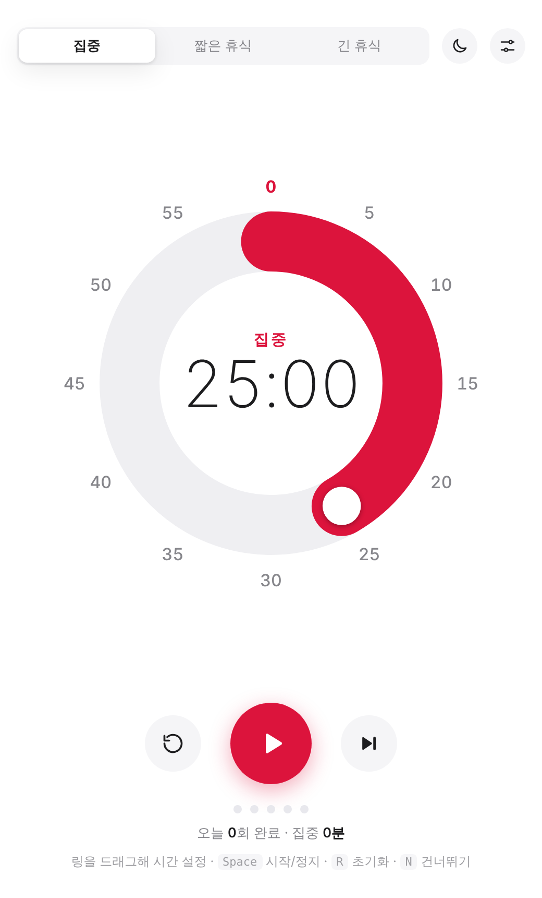
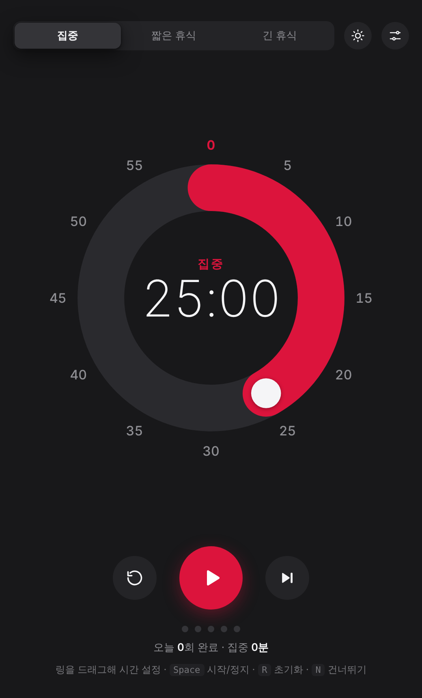

# Pomodoro Timer

미니멀 뽀모도로 타이머입니다.
설치나 빌드 없이 HTML 파일 하나로 동작합니다.

<p align="center">
  
  
</p>

## 기능

- **60분 링 다이얼**: 남은 시간만큼 링이 채워지고, 시간이 흐르면 0 쪽으로 줄어듭니다.
- **드래그로 시간 설정**: 링을 잡고 돌려 1~60분을 맞춥니다.
- **자동 루틴**: 집중 → 짧은 휴식을 반복하다가, 정해진 횟수마다 긴 휴식으로 넘어갑니다.
- **정확한 타이밍**: 종료 시각을 기준으로 계산해서 백그라운드 탭에서도 시간이 밀리지 않습니다.
- **알림**: 완료 차임, 마지막 1분 링 깜빡임, 탭 제목 카운트다운, 종료 예정 시각 표시
- **라이트 / 다크 모드**: 기기 설정 자동 연동 또는 수동 전환
- **다이얼 눈금 3종**: 기본(1분 눈금) · 15분 · 5분
- **오늘 기록**: 완료 세션 수와 총 집중 시간을 보여줍니다. 날짜가 바뀌면 초기화됩니다.
- **오프라인 / 앱 설치**: 웹에 올리면 PWA로 설치해 독립 창으로 쓸 수 있습니다.

## 기본 루틴

| 항목 | 기본값 |
| --- | --- |
| 집중 | 25분 |
| 짧은 휴식 | 5분 |
| 긴 휴식 | 10분 |
| 긴 휴식 간격 | 집중 5회마다 |
| 휴식 자동 시작 | 켜짐 |
| 집중 자동 시작 | 꺼짐 |
| 다이얼 눈금 | 5분 |

설정은 새로고침하면 위 기본값으로 돌아갑니다. 오늘 기록만 브라우저에 저장됩니다.
기본값을 바꾸려면 `index.html`에서 `DEFAULTS`를 수정하세요.

## 단축키

| 키 | 동작 |
| --- | --- |
| `Space` | 시작 / 일시정지 |
| `R` | 초기화 |
| `N` | 다음 세션으로 건너뛰기 |
| `1` `2` `3` | 집중 / 짧은 휴식 / 긴 휴식 |
| `←` `→` | 다이얼 포커스 상태에서 ±1분 |
| `Esc` | 설정 닫기 |

## 실행

`index.html`을 더블클릭해 브라우저로 열면 바로 동작합니다.

오프라인 캐시와 앱 설치는 `http(s)`로 열 때만 동작하므로, 로컬에서 시험하려면 간단한 서버를 띄우세요.

```bash
python -m http.server 8000
# http://localhost:8000 접속
```

## GitHub Pages 배포

`main` 브랜치에 푸시하면 `.github/workflows/pages.yml`이 자동으로 배포합니다.

1. 저장소 **Settings → Pages → Build and deployment → Source**를 **GitHub Actions**로 바꿉니다.
2. `main`에 푸시하면 `https://<아이디>.github.io/<저장소이름>/`에서 열립니다.

앱 파일을 수정한 뒤 배포할 때는 `sw.js`의 `VERSION`을 올려야 사용자 캐시가 갱신됩니다.

## 구조

```
.
├── index.html             # 앱 전체 (HTML · CSS · JS)
├── sw.js                  # 오프라인 캐시용 서비스 워커
├── manifest.webmanifest   # PWA 설치 정보
├── icon.svg, icon-*.png   # 앱 아이콘
├── docs/                  # README 스크린샷
└── .github/workflows/     # GitHub Pages 자동 배포
```

## 예정

- Windows 데스크톱 위젯 (Tauri): 항상 위에 떠 있는 작은 링 창, 트레이 아이콘, 시스템 알림

## License

[MIT](LICENSE) © 2026 Sungjun Park
